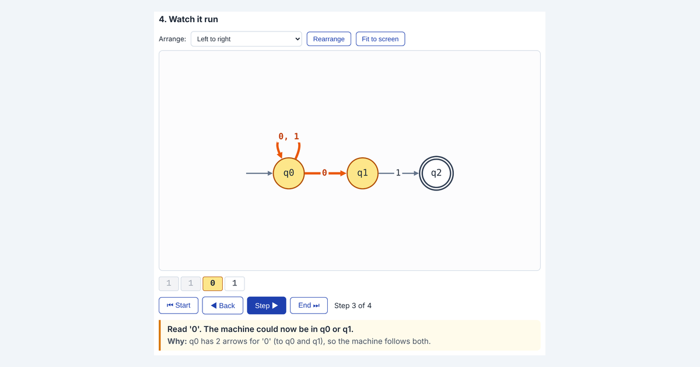
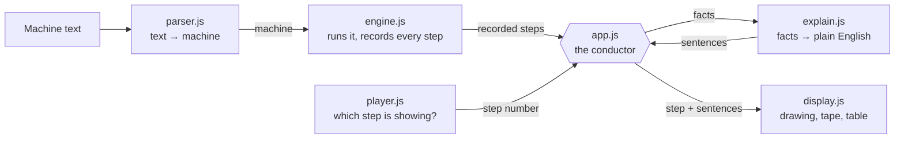

# NFA Visualizer

Watch a **nondeterministic finite automaton (NFA)** read a string one character at a time, with the machine drawn as circles and arrows and every step explained in plain English. It's written so a middle or high schooler can follow along.

**▶ Try it: https://bquant90.github.io/nfa-visualizer/**



It runs entirely in your browser. There's no server, no database and no sign-up, and it works on phones, in dark mode, and with your browser's built-in translation.

---

## How to use it

1. **Pick an example** from the "Try an example" list, or write your own machine (format below).
2. **Pick a string to test.** Type one, or click one of the test strings from the description.
3. **Step through it** with **Step ▶** / **◀ Back** (or the → and ← keys). Yellow circles show where the machine could be. Orange arrows are the ones just used. A red dashed circle is a guess that hit a dead end.
4. **Reach the end** to see the verdict, green for accepted and red for rejected, with a sentence explaining why.

**Share a machine:** click **Copy link to this machine**. Anyone who opens the link sees your machine and test string. The machine is stored in the link itself, so nothing is uploaded anywhere.

## Writing your own machine

Each line is `label: value`. Blank lines and lines starting with `#` are ignored. The order doesn't matter.

| Label       | Meaning                                                           | Example                                     |
| ----------- | ----------------------------------------------------------------- | ------------------------------------------- |
| `alphabet`  | The characters the machine can read                               | `alphabet: 0, 1`                            |
| `states`    | Every state (circle)                                              | `states: q0, q1, q2`                        |
| `start`     | The one state it starts in                                        | `start: q0`                                 |
| `accepting` | The "winning" states (double circles)                             | `accepting: q2`                             |
| `rule`      | "In state X, reading Y, you may move to Z." Can repeat.           | `rule: q0 -- 0 --> q1` or `rule: q0, 0, q1` |
| `test`      | A string to try. Can repeat. Leave it empty for the empty string. | `test: 101`                                 |

Lists can use commas or spaces. Two rules with the same state and character make the machine **nondeterministic**: it follows both.

```
# Accepts strings of 0s and 1s that end in "01"
alphabet: 0, 1
states: q0, q1, q2
start: q0
accepting: q2

rule: q0 -- 0 --> q0
rule: q0 -- 1 --> q0
rule: q0 -- 0 --> q1
rule: q1 -- 1 --> q2

test: 101
test: 1100
```

This is the same format the original Python version reads (`python/project_1_revamp.py`). No epsilon ("free") moves yet.

---

## How it's built

Plain HTML, CSS and JavaScript, with no build tools. The one library is [Cytoscape.js](https://js.cytoscape.org/) for drawing. The key idea is **record first, play back second**: the engine runs the whole string once and records every step as data, and the page just flips through those recorded steps. `app.js` is the conductor: it calls each part in order and passes results between them, so each part (parsing, running, wording, drawing) can change on its own. The only thing the parts share is a few small helpers from `parser.js`, like sorting state names.



| File                         | Job                                                                                                 |
| ---------------------------- | --------------------------------------------------------------------------------------------------- |
| `index.html`                 | The page: layout and buttons, no logic                                                              |
| `css/style.css`              | Every color (light and dark) and all spacing                                                        |
| `js/theme.js`                | Light / dark / auto, loaded first to avoid a white flash                                            |
| `js/parser.js`               | Turns `label: value` text into a machine, or a list of problems                                     |
| `js/engine.js`               | Runs the machine on a string and records every step as facts                                        |
| `js/explain.js`              | Turns those facts into captions and the final verdict                                               |
| `js/display.js`              | Draws with Cytoscape and shows the tape, table and captions. The only file that talks to Cytoscape. |
| `js/player.js`               | Steps back and forth through recorded steps. Knows nothing about NFAs, so it's reusable.            |
| `js/presets.js`              | The example machines                                                                                |
| `js/app.js`                  | The glue: connects buttons to everything else                                                       |
| `check.html` + `js/check.js` | Testing tool: prints results in the Python version's exact format                                   |
| `lib/cytoscape.min.js`       | Cytoscape.js 3.35.0 (MIT license)                                                                   |

Every big choice, and what was passed on, is in **[docs/DECISIONS.md](docs/DECISIONS.md)**. New terms are in **[docs/GLOSSARY.md](docs/GLOSSARY.md)**.

## How we know it's right

The original Python verifier is the **answer key**. `check.html` prints results in exactly the format the Python prints (including `--trace`), so the two can be compared line by line:

1. Run Python on every test file and copy the output (Windows PowerShell):
   ```
   Get-ChildItem test-files\*.txt | ForEach-Object { "===== $($_.Name)"; cmd /c "py -3.15 python\project_1_revamp.py test-files\$($_.Name) 2>&1" } | Set-Clipboard
   ```
2. Open `check.html`, choose all files in `test-files/`, and click **Copy output**.
3. In VS Code, run **Compare New Untitled Text Files** and paste one into each side. There should be no differences.

The `test-files/` folder covers good machines, broken ones (every error message), unknown characters, and two big machines.

## Run it on your own computer

Download or clone the repo and open `index.html` in a browser. That's it. For editing, VS Code's **Live Server** extension refreshes the page on every save.

## History

Originally built in April 2022 as a Python command-line project for a Theory of Automata class by **Bryan Quant, Colbin Hobbs and Bhumik Bhakta**. Remastered in 2026 by Bryan Quant, with AI assistance, as an interactive teaching tool.
